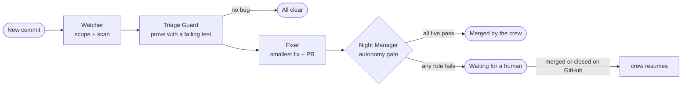

# Night Shift

**A crew of four AI agents that guards a codebase: it proves every security bug with a failing test, fixes it, and merges the fix on its own only when it can prove the fix is safe. Everything else waits for a human.**

[](https://github.com/JacksonDescant/night-shift/actions/workflows/ci.yml)

> **Winner of a SpaceXAI-sponsored prize** at ACM@UCSD's *Five Nights with AI* hackathon (October 2026), for its use of Grok Bots. See [Origin](#origin).

Security scanners hand you a list. Night Shift hands you **evidence**: a test that fails on your current code, a minimal fix, the same test passing on the fix, and a record of exactly why the fix was or wasn't safe to merge without you.

It's built for teams that want an always-on security reviewer without giving an AI the keys to production.

## How it works

Four agents (Grok Bots) work as a crew, handing work to each other in a shared chat:

| Agent | Job |
|---|---|
| **Watcher** | Wakes on every push (or a scheduled patrol), works out which parts of the code changed, and runs the scanners on just those parts. |
| **Triage Guard** | Decides what's real. Reads the change and the code for logic bugs scanners miss, and writes a **proof**: a test asserting the safe behaviour, which must *fail* before anything counts as a bug. |
| **Fixer** | Writes the smallest fix in its own workspace, checks it, and opens a pull request with the proof as a regression test. |
| **Night Manager** | Runs the **autonomy gate** on the PR, merges it if every rule passes, escalates it to a human if not, and keeps the work going until the task is done. |



### The autonomy gate

A fix merges itself only when **all five** hold, checked in clean git worktrees and an isolated environment:

1. **The proof fails on the vulnerable code.** The bug was real.
2. **The same proof passes on the fix.**
3. **Nothing else broke.** The repository's own tests pass and no other proof newly fails.
4. **The diff is small and stays inside the bug's component** (12 changed lines by default).
5. **Nothing sensitive changed.** No auth code, dependencies, migrations, CI or infrastructure.

Anything else is escalated: the PR stays open, the dashboard lists it under *Waiting for you* with the failed rules, and the crew moves on to other work. When you merge or close it on GitHub, the dashboard notices and the crew carries on.

### Attack paths, not just findings

Individually minor bugs matter when they line up. Night Shift keeps a **map** of each repository: its components, which ones face the internet (*entry points*), where the valuable data lives (*assets*), and how components reach each other. A proven bug lets an attacker cross into its component; a chain of them from an entry point to an asset is a **breach path**.

The crew uses the map to decide what to fix first. If a breach path exists, it finds the smallest set of fixes that cuts every one. Otherwise, it picks the fix that pushes an attacker back the furthest. Patrols spend attention on the components closest to assets, recently changed, or buggy before.

## Safety model

- **Proofs never touch production.** Every proof and every check runs in the *mimic*: a throwaway Docker container built from the repository's own dependencies, with no network, the code mounted read-only, and no real data. Without Docker, it falls back to a cached local virtualenv.
- **The default branch only changes through pull requests.** The crew never commits to it directly, and only the gate can merge.
- **Least-privilege tokens.** Each connected repository uses its own fine-grained GitHub token (Contents and Pull requests, on that one repository). The dashboard stores it with owner-only file permissions and never returns it from its API.
- **Local-only controls.** The dashboard's actions and settings only answer requests from the machine it runs on, never through a tunnel or proxy. The crew posts progress with a separate bearer token.
- **Graduated autonomy, with a kill switch.** Set `autonomy.enabled: false` in `nightshift.yaml`, or `NIGHTSHIFT_AUTOMERGE=0`, and every fix waits for a human.

## Getting started

You need Python 3.11+, git, and (recommended) Docker. The crew runs on Grok Bots; see **[docs/crew-setup.md](docs/crew-setup.md)** for the full walkthrough.

```bash
git clone https://github.com/JacksonDescant/night-shift.git && cd night-shift
make install        # creates .venv and installs Night Shift
make dashboard      # http://127.0.0.1:8000
```

1. **Set up the crew** once, following [docs/crew-setup.md](docs/crew-setup.md): four Grok Bots, their instructions from `bots/`, and `scripts/install-crew.sh` on their computer.
2. **Open Settings** in the dashboard and paste the Watcher routine's webhook. Copy the progress token to the crew.
3. **Connect a repository**: owner/name plus a fine-grained token for that repository.
4. The crew **drafts a map** of the repository and opens it as a PR. Review it, adjust anything wrong, and merge it.
5. From then on, every push (via the optional GitHub webhook), patrol or full sweep wakes the crew.

## The map: `nightshift.yaml`

The crew drafts this file from the code (routes, database drivers, imports, auth decorators) and proposes it as a PR. It lives in the guarded repository, so changes to it go through review like any other code.

```yaml
version: 1
components:
  api:
    name: Public API
    paths: ["shop/api/"]                # a directory, a file, a glob, or file.py:function
    entry: true                         # reachable from outside
  orders:
    name: Orders
    paths: ["shop/orders/"]
  db:
    name: Database
    paths: ["shop/db.py"]
    asset: true                         # where the valuable data lives
links:                                  # who can reach whom
  - [api, orders]
  - [orders, db]
sensitive:                              # changes here always need a human (added to the built-in list)
  paths: ["shop/settings.py"]
  symbols: ["shop/auth.py:require_admin"]
  decorators: ["@login_required"]
tests_dir: tests/nightshift             # where proofs live once committed
autonomy:
  enabled: true
  max_changed_lines: 12
```

The built-in sensitive list always applies: dependency manifests and lockfiles, migrations, `.github/`, Dockerfiles, and `nightshift.yaml` itself.

## Proofs

A proof is an ordinary pytest file. Its docstring names the bug and the component it lives in:

```python
"""Night Shift proof: users can read other users' orders [component: orders]"""
from shop.orders import get_order


def test_only_own_orders():
    assert get_order(order_id=2, user="alice") is None   # order 2 belongs to bob
```

Triage Guard writes it to `.nightshift/proofs/` (untracked) and runs `nightshift bug confirm`, which counts the bug only if the test *fails* in the mimic. The Fixer commits it beside the fix as `tests/nightshift/test_<bug>.py`, where it stays as a regression test: if the bug ever comes back, its proof catches it at once.

## CLI

The crew drives everything through one CLI, one step per command. Commands that print `HAND OFF:` tell the agent who works next, and only `nightshift next` printing `DONE:` ends a task.

| Command | What it does |
|---|---|
| `nightshift wake '<json>'` | The Watcher's whole job: clone or sync, tidy, pick components for the trigger (push, patrol, full, bug, resume, map), scan, save the task |
| `nightshift map draft \| propose \| show` | Draft the component map, propose it as a PR, or print it |
| `nightshift scan [--components a,b]` | Semgrep, Bandit, gitleaks and pip-audit, scoped to components, minus known false positives |
| `nightshift bug confirm <id>` / `bug dismiss <finding>` | Prove a bug in the mimic, or dismiss a false positive for good |
| `nightshift paths` | Run every proof, compute attack paths and the most valuable fix |
| `nightshift next` | What the crew does next for the current task, or `DONE` |
| `nightshift fix start \| ship <bug>` | The Fixer's isolated worktree; then verify, push and open the PR |
| `nightshift gate <bug> [--apply \| --ci]` | The five-rule autonomy gate; merge, escalate, or report in CI |
| `nightshift sync` / `tidy` | Keep the shared checkout on GitHub's latest; clear leftover branches and folders |
| `nightshift patrol` | Show patrol risk scores per component |

To show the gate's verdict on every crew PR, copy [`templates/nightshift-gate.yml`](templates/nightshift-gate.yml) into the guarded repository's `.github/workflows/`.

## Project layout

```
nightshift/      the crew's toolkit: CLI, map drafting, attack paths, proofs and mimic, gate, GitHub, memory
server/          the dashboard: FastAPI backend (connect, events, webhooks, review watcher) and a static web UI
bots/            the four agents' instructions and shared rules
scripts/         install-crew.sh for the crew's computer
templates/       a GitHub Actions workflow for guarded repositories
tests/           the test suite (runs against a small sample repository)
```

## Limitations

- **Python first.** Map drafting, proofs (pytest) and Bandit are Python-specific. The interfaces are language-neutral, so other ecosystems can be added.
- **The map is a model.** The draft is heuristic; it's only as good as the review it gets. Attack paths are a prioritisation aid, not a guarantee.
- **The agents are only as careful as their rules.** The gate is deliberately strict, and the defaults lean toward asking a human.
- **One crew per dashboard.** The crew works one task at a time across connected repositories.

## Origin

Night Shift started as a hackathon project at ACM@UCSD's *Five Nights with AI* (October 2026), where it won a SpaceXAI-sponsored prize for its use of Grok Bots. This repository is the cleaned-up, general-purpose version of that idea.

## Contributing and security

Contributions are welcome. See [CONTRIBUTING.md](CONTRIBUTING.md). To report a vulnerability in Night Shift itself, see [SECURITY.md](SECURITY.md).

## License

[MIT](LICENSE)
